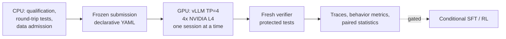

# Measure Before You Train

**Reliable local Gemma 4 software-engineering agents: an evidence-gated strategy for a 4-bit 31B model on four NVIDIA L4 GPUs, with weight-space-programming experiments on Gemma 4 E4B.**

Author: **Prathy P** · Submission to the *Gemma 4 Developer Agent Competition*, Paper Track

> **Status: research in progress.** This repository documents the system design, tooling and test strategy behind the paper. It reports **no benchmark results and no performance claims**. Components that have not been executed on GPU hardware are labeled as such below.

---

## Overview

Locally served models are the only route to software-engineering agents that run without commercial APIs, but multi-turn repository repair remains unreliable for models that fit one accelerator node. The competition fixes the base model, the serving engine and the scoring harness. What remains controllable is a declarative configuration, an optional LoRA adapter, and the **process used to decide between them**.

The premise of this work: **reliability must be established before capacity is added.** Every stage begins with a measurement and ends with an acceptance gate; training is conditional on evidence that it is warranted.

Two observations motivate the design:

- **Sessions are decode-bound.** If generation dominates session time, the usable output budget is approximately $N_{\text{tok}} \approx T \cdot r$ (time cap × decode rate). Faster tools cannot raise the solve rate; fewer wasted tokens can.
- **A malformed edit-call loop wastes that budget.** The Gemma chat template orders tool arguments alphabetically (`new_string` before `old_string`). When the model closes `new_string` with a backtick instead of the string delimiter, the vLLM parser absorbs `old_string`, the harness reports a missing argument, and the model resends the same call. Failed calls are not charged to the tool budget, so only the session clock ends the loop.

## Strategy: four gated stages

A stage starts only when the preceding stage passes its gate.

| Stage | Work | Key reference | Gate |
|---|---|---|---|
| 1. Tool-call reliability | Exact-template/parser round-trip tests; simpler editing-tool experiment; stop sequence on the malformed prefix; behavior metrics | Feedback That Backfires (arXiv:2608.23651) | Fewer malformed and repeated calls on fresh tasks |
| 2. Verified native data | Trajectories generated with the shipped tools, kept only if verified; deduplicated; issue-disjoint splits | SWE-Gym (arXiv:2412.21139) | Clean, diverse, held-out-safe data |
| 3. Compact SFT *(conditional)* | Small LoRA adapter on verified trajectories | SWE-Zero to SWE-Hero (arXiv:2604.01496), LoRA (arXiv:2106.09685) | Held-out gain, export parity, decode-speed check |
| 4. RL update *(conditional)* | Audit, then qualify, a resolution-prioritized objective | HERO (arXiv:2609.38885) | Correct objective, finite gradients, reload parity |

HERO (RL) and SWE-Hero (SFT) are distinct methods and are not conflated. Human-feedback RLHF is out of scope: no human preference labels exist, and verifier outcomes serve as the reward.

## System design



| Layer | Responsibility |
|---|---|
| **CPU** | Task qualification (empty-patch and reference-patch controls), dependency wheels, tool-call round-trip tests, data admission, statistics |
| **GPU** | One tensor-parallel vLLM server (organizer-pinned runtime) on four L4 GPUs; independent workspace per session |
| **LLM** | Frozen Gemma 4 31B W4A16 is the only deployed model; Gemma 4 E4B is a low-cost subject for weight-space probes and is never deployed |

**Memory is admitted separately for serving and training** (per device):

$$V_{\text{serve}} = W + K + P + S + D + H, \qquad V_{\text{train}} = W' + A + G + O + S + X + H$$

(weights, KV cache, graph pools, workspaces, adapters, headroom; training adds the dequantized base $W'$, activations, gradients, optimizer state and export staging). W4A16 storage does not guarantee a working autograd path, so training uses a frozen dequantized base distributed across devices.

**NVIDIA stack.** CUDA, cuBLAS, cuDNN, CUTLASS, FlashInfer and NCCL remain as the organizer configured them; their actual use is verified by profiling, not assumed. TensorRT-LLM and the solver, sparse, scientific and quantum libraries are not selected. nvmath-python, cuDF, cuVS and similar libraries are conditional micro-experiments only after profiling shows a need.

## Weight-space programming on Gemma 4 E4B

Following the investigative method of *Sparks of Weight-Space Programming*, the study asks whether a closed-form rank-one edit can correct a diagnosed generation failure (repetition after the reasoning block closes) once prompt-format causes are excluded.

For a projection $W$, a unit output direction $u$ and the projector $P_C$ onto selected input columns:

$$\Delta W = -\gamma\, u\, v^{\top}, \qquad v = P_C W^{\top} u$$

The edit fits one LoRA slot ($A[0,:]=v$, $B[:,0]=-(\gamma/s)\,u$). Since $u^{\top}(W+\Delta W)P_C = (1-\gamma)\,u^{\top}WP_C$, $\gamma = 1$ removes the selected component and $\gamma > 1$ reverses it, so only $0 < \gamma \le 1$ is searched.

**Controls:** untouched base, serialized zero-delta adapter, norm-matched random direction, group-shuffled labels. Evidence precedes any edit (module-output capture, cross-fold stability, teacher-forced dose response), and the finalist is frozen before held-out data is opened.

**Current status.** An initial audit found post-close repetition, but the saved prompts had not declared the tools the system prompt instructed the model to use. A paired format test favored a prompt-format cause, yet under the pre-registered rule the outcome was inconclusive. **No direction or edit has been produced.** The next step is a revised protocol on the native multi-turn tool path; if the failure disappears there, the edit branch is closed as format-caused. The 31B variant is implemented but has not been run on a GPU.

## Evaluation protocol

Outcomes are paired by task and analyzed with an exact binomial test, a task-level bootstrap, leave-one-repository-out checks and Wilson intervals. The number of tasks needed is approximately

$$n \approx \frac{\left(1.645\sqrt{\pi} + 0.84\sqrt{\pi - \delta^{2}}\right)^{2}}{\delta^{2}}$$

for discordant share $\pi$ and gain $\delta$ (one-sided $\alpha=0.05$, power $0.8$): about 121 tasks for a 10-point gain and 490 for 5 points at $\pi = 0.2$. Small panels therefore support behavior-metric screening, not solve-rate rankings. Run-to-run noise is measured first, promotion rules are fixed before outcomes, and a failed rule is never relaxed afterwards.

## Engineering rules

- Reference patches, required-test patches and gold outcomes are **verifier-only**; they never enter prompts, retrieval examples or training targets.
- Evaluation groups stay disjoint from training data; deduplication keys on (repository, base commit, issue-text hash).
- Training targets are rendered with the exact attached chat template and parsed with the organizer's parser; corrupted calls and error targets are masked.
- Every candidate is immutable once evaluated; promotion rules are fixed before outcomes and never relaxed afterwards.
- Work items carry stable identities and hashes; health-check failures are infrastructure events, and bad outcomes are never discarded to improve a rate.

## Scope and limitations

- Stages 2 to 4, the engineering experiments (record-batch reader, double buffering, concurrency ramp, fault injection) and the weight edit are **designs with gates, not executed experiments**.
- Local sandboxes may differ from the hidden scorer; findings reported for sub-2B models are untested at 31B.
- Related work that is **not** a promised component: Bellman Policy Optimization (2609.15987), LEAP (2608.01804), BunshinRL (2611.10453) and Skill-R1 (2605.09359; it needs a second trained model, which the single-model rule forbids).

## Related papers

| Paper | Role |
|---|---|
| SWE-bench (2310.06770), Failure as a Process (2607.09510) | Problem setting and failure analysis |
| vLLM / PagedAttention (2309.06180), Megatron-LM (1909.08053), GPipe (1811.06965) | Serving and parallelism background |
| Feedback That Backfires (2608.23651), Beyond Accuracy (2611.02368) | Tool-call repetition and quantization behavior |
| SWE-Gym (2412.21139), SWE-Zero to SWE-Hero (2604.01496), LoRA (2106.09685), LoRazor (2611.10049) | Data, supervised adaptation and adapter overhead |
| HERO (2609.38885) | Resolution-prioritized RL for token-efficient agents |
| Sparks of Weight-Space Programming | Method for the E4B study |
| What Does a Harness Buy? (2610.04433), Cross-Benchmark Transfer from RL (2610.00890), Let the Fixer Decide (2611.12164), How Should Agents See Code? (2611.07286), Code Understanding is a Bottleneck (2610.10610), Gemma 4 Technical Report (2607.02770) | Framing of metrics, training and architecture |

## Not included in this repository

Model weights, the competition data kit, run artifacts and credentials are not redistributed. Obtain the Gemma 4 checkpoints and competition files from their official sources and respect their licenses.

## Citation

```bibtex
@misc{prathy2026measure,
  author = {Prathy P},
  title  = {Measure Before You Train: Reliable Local Gemma 4 Software-Engineering Agents},
  year   = {2026},
  note   = {Gemma 4 Developer Agent Competition, Paper Track}
}
```

## License

Released under the [Apache License 2.0](LICENSE).
